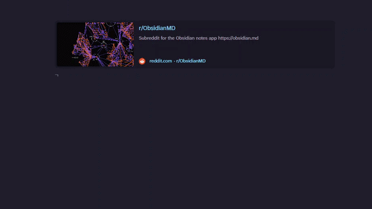

<div align="center">

# Auto Card Link Enhanced

**Paste a URL, get a card.**<br>
Title, description, thumbnail and favicon, fetched for you, as a `cardlink` block or a clean Markdown link.

<a href="https://github.com/KreNtal/obsidian-auto-card-link/releases/latest"></a>
<a href="https://community.obsidian.md/plugins/auto-card-link-enhanced"></a>


<a href="LICENSE"></a>

[**Install**](#installation) · [Features](#features) · [Settings](#settings) · [Network use](#network-use) · [Syntax](#cardlink-syntax) · [Styling](#customizing-the-style) · [Motivation](#motivation)

</div>

<br>

Most link previews read a page's tags and stop there. This one also knows **over sixty sites** well enough to get them right: YouTube, Reddit, X, TikTok, Facebook, LinkedIn, Pinterest, GitHub, Stack Exchange, Wikipedia, Spotify, Steam, Google Maps, Notion, Discord and more. A deleted post gets a card that says so, not one describing the site's error page or sign-in wall.

<p align="center">
  
</p>

## Installation

**From Obsidian:** open **Settings → Community plugins → Browse**, search for **Auto Card Link Enhanced**, then select **Install** and **Enable**. Or [open it in the plugin directory](https://community.obsidian.md/plugins/auto-card-link-enhanced).

**By hand:** download `main.js`, `manifest.json` and `styles.css` from the [latest release](https://github.com/KreNtal/obsidian-auto-card-link/releases/latest) into `<your vault>/.obsidian/plugins/auto-card-link-enhanced/`, then reload Obsidian and enable the plugin.

## Features

- 🔗 **Paste or drop a URL** and turn it into a card, or into an inline Markdown link (`[title - Site](url)`) carrying the title fetched from the page.
- ✨ **Convert URLs already in a note**, one or several at once, from the right-click menu or a hotkey.
- 🖱️ **Right-click a card** to refresh, delete, add a line after it, or turn it back into a Markdown link.
- 🔁 **Right-click a Markdown link** to refresh its title or turn it into a card.
- ⌨️ **Separate commands** for cards and Markdown links, so each can have its own hotkey and both can be used side by side.
- 🖼️ **Local images** through internal links (`image: "[[image.png]]"`).
- 🪦 **Links to content that is gone**, such as a deleted post, a removed video or an expired invite, produce a card built from the URL, not a confident-looking card describing the site's own error page or sign-in wall. The card is marked `status: not-found`, and its title is marked the way the settings say.

## Settings

| Setting | What it does |
| --- | --- |
| **Paste and drop** | What pasting or dropping a URL produces, chosen separately for each: a plain URL, a Markdown link, or a card. |
| **Context menu** | Adds the commands to the right-click menu. |
| **Local saving** | Saves images and favicons in your vault, in folders you choose. |
| **Card style** | The look of the card, with the thumbnail on the left or on the right. |
| **Thumbnail quality** | Best looking or maximum resolution. |
| **External service** | Uses an external service as a fallback for blocked sites. Off by default. |
| **Links that are not found** | Strikes the title through (default), puts a text of your choice before it, or leaves it as it is. Cards follow the setting as it is now, including cards already in your notes. Markdown links keep the mark they were written with. |

## Network use

This plugin needs internet access to fetch link metadata. Here is exactly what it sends, and where.

- **By default**, it fetches metadata **directly from the site you are linking to**, the same request your browser would make to load that page. If the site refuses that request, the plugin asks the same site again the way link previews do, as Facebook's, Slack's or WhatsApp's link-preview agent, still directly and to that site only. Nothing is sent to any other third party.
- **Optionally**, if you enable **Use external service for blocked sites** in the settings, the plugin will, **only when a direct fetch fails**, send the link's URL to the third-party service [microlink.io](https://microlink.io) to retrieve metadata from sites that block direct access (for example Cloudflare-protected pages). This setting is **off by default**, and no data is ever sent to microlink.io unless you turn it on.

> [!IMPORTANT]
> No analytics, telemetry, or personal data are collected by this plugin.

## Cardlink syntax

A card is a `cardlink` code block written in YAML, so your notes stay plain text: no HTML, and readable without the plugin.

````
```cardlink
url: https://obsidian.md/
title: "Obsidian - Sharpen your thinking"
description: "The free and flexible app for your private thoughts."
host: obsidian.md
favicon: https://obsidian.md/favicon.ico
image: https://obsidian.md/images/banner.png
```
````

### Attributes

| Name | Required | Description |
| --- | :---: | --- |
| `url` | ✅ | URL to open when you click the card |
| `title` | ✅ | Title of the link |
| `description` | ❌ | Description of the link |
| `host` | ❌ | Host of the link |
| `favicon` | ❌ | Favicon of the link |
| `image` | ❌ | Thumbnail shown in the card |
| `author` | ❌ | Channel or author, if there is one |
| `duration` | ❌ | Duration of a video |
| `status` | ❌ | `not-found` when the site says the page is not there; the title is then marked as the settings say |

## Customizing the style

Cards are styled by [styles.css](./styles.css), and a [CSS snippet](https://help.obsidian.md/How+to/Add+custom+styles#Use+Themes+and+or+CSS+snippets) can override any of it. For example, to hide the author:

```css
.auto-card-link-author {
	display: none;
}
```

## Contributing

A site that gives a poor card, or none at all? [Ask for it to be checked](https://github.com/KreNtal/obsidian-auto-card-link/issues/new/choose).<br>
For anything else, [open a bug report](https://github.com/KreNtal/obsidian-auto-card-link/issues/new/choose).

## Motivation

- Wanted to show beautiful links in my notes
- Didn't want to mess up my notes with HTML tags
- Wanted to keep the original plugin updated (KreNtal)

## Credits

This is a fork of [obsidian-auto-card-link](https://github.com/nekoshita/obsidian-auto-card-link) by Nekoshita Yuki, and has been maintained by [KreNtal](https://github.com/KreNtal) since 2026-05-04.
